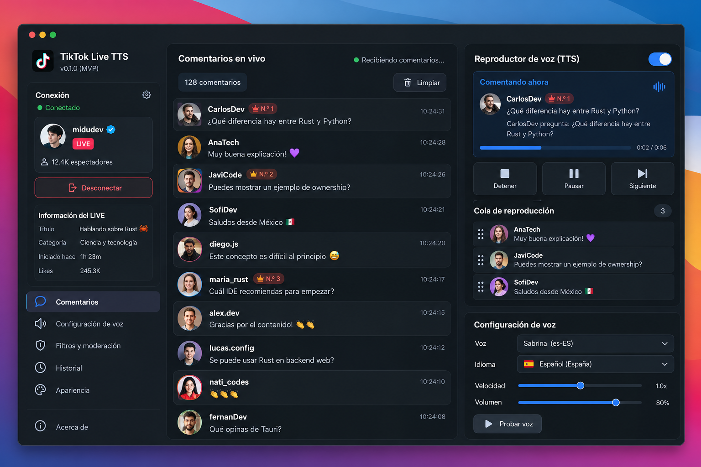

# TikTok Live TTS para macOS

**Escucha los comentarios de tu TikTok LIVE con las voces de tu Mac.**

Aplicación de escritorio para la comunidad de macOS, construida con Tauri y Rust. Recibe comentarios, los filtra y los reproduce uno a uno con el motor de voz nativo de Apple. Puedes usar lectura automática o elegir manualmente qué comentarios escuchar.

El TTS funciona localmente, sin suscripciones ni servicios de generación de voz. La conexión a TikTok es **no oficial** y depende de servicios externos de TikTok y de firma; consulta [Conexión real y firma](#conexión-real-y-firma).

**Estado: MVP 0.2.0.** El modo demostración y la lectura de comentarios de un LIVE real se validaron en un Mac Apple Silicon. Este repositorio distribuye el código fuente para compilarlo localmente; no incluye un instalador firmado ni un paquete universal.



## Funcionalidades

- Conexión a TikTok LIVE por nombre de usuario, desconexión y reintentos con backoff.
- Modo demostración con comentarios, espectadores y regalos simulados identificados como **DEMO**; el audio usa voces reales de macOS.
- Comentarios reales identificados como **LIVE**, sin sustituir errores de conexión por datos simulados.
- Voces instaladas de macOS, selección por idioma, velocidad, volumen y prueba de voz.
- Cola FIFO: una sola lectura a la vez, con pausa, reanudación, salto y eliminación de pendientes.
- Lectura automática o selección manual de comentarios.
- Opción **Leer nombre del usuario**: escucha `usuario dice: comentario` o solo el texto. Se guarda automáticamente.
- Contador de espectadores **actuales**, actualizado con los eventos de TikTok; muestra `—` si no hay dato o se desconecta.
- Regalos con remitente, nombre y cantidad; las rachas se cuentan una vez, al finalizar. Lista de los últimos 100 envíos y total de la sesión.
- Opción **Anunciar regalos**, desactivada por defecto; comparte la cola de voz y respeta palabras bloqueadas y usuarios silenciados.
- Solo comentarios y regalos nuevos desde cada conexión: se descarta el historial inicial y los eventos anteriores, también al reconectar.
- Filtros de palabras, usuarios silenciados, duplicados, longitud y mensajes compuestos solo por emojis o símbolos.
- Límite y caducidad configurables para la cola.
- Preferencias persistentes en SQLite e historial opcional, desactivado por defecto.
- Interfaz de tres columnas, búsqueda, desplazamiento automático y temas oscuro/claro.

## Compatibilidad

| Componente            | Requisito                                                        |
| --------------------- | ---------------------------------------------------------------- |
| Sistema               | macOS; versión mínima configurada de la app: 13.0                |
| Arquitectura validada | Apple Silicon, `arm64`                                           |
| Node.js               | **22.12 o superior**, instalado para la arquitectura del Mac     |
| Rust                  | Canal estable, con Cargo                                         |
| Herramientas Apple    | Xcode Command Line Tools con Swift y SDK macOS, o Xcode completo |
| Red                   | Necesaria para instalar dependencias y conectar a un LIVE real   |

La compatibilidad con la versión mínima de macOS y con Intel no se ha probado en hardware independiente. El empaquetado incluye Node y el helper Swift de la arquitectura de la máquina que compila. Para un Mac Intel hay que compilar en Intel con sus herramientas correspondientes; cambiar solo el target de Rust no genera un paquete completo para otra arquitectura.

El motor de voz requiere macOS. El proyecto no ofrece soporte para Windows o Linux.

## Preparar tu Mac

### 1. Herramientas de Apple

En Terminal:

```sh
xcode-select --install
```

Completa la instalación y comprueba que puedes usar Swift:

```sh
xcode-select -p
swiftc --version
```

Si tienes Xcode completo y aparece un error sobre su licencia, revísala y acéptala desde Terminal con `sudo xcodebuild -license`. Si prefieres las Command Line Tools y ya están instaladas, puedes seleccionarlas para esta sesión:

```sh
export DEVELOPER_DIR=/Library/Developer/CommandLineTools
```

Más información: [requisitos oficiales de Tauri para macOS](https://v2.tauri.app/start/prerequisites/#macos).

### 2. Node.js

Instala Node **22.12+** desde [nodejs.org](https://nodejs.org/en/download) o con tu gestor de versiones habitual. Verifica:

```sh
node --version
npm --version
node -p process.arch
```

En Apple Silicon, la última línea debe indicar `arm64` para generar un paquete nativo de esa arquitectura. Evita mezclar Node bajo Rosetta con Rust nativo.

### 3. Rust

Instala Rust con [rustup, desde su sitio oficial](https://rust-lang.org/tools/install/):

```sh
curl --proto '=https' --tlsv1.2 -sSf https://sh.rustup.rs | sh
```

Abre una nueva Terminal, o carga el entorno de Cargo:

```sh
source "$HOME/.cargo/env"
rustc --version
cargo --version
```

Si ya tienes Rust, actualiza el canal estable cuando sea necesario con `rustup update stable`.

## Clonar y ejecutar

```sh
git clone https://github.com/jesteban19/tiktok-live-tts-macos.git
cd tiktok-live-tts-macos
npm ci
npm run tauri dev
```

La primera ejecución compila el helper Swift, prepara el puente de TikTok, incluye el runtime Node e inicia la interfaz y el backend Rust. La primera compilación de Rust puede tardar varios minutos.

No necesitas instalar Tauri globalmente: el proyecto usa su CLI local. `package-lock.json` y `src-tauri/Cargo.lock` se incluyen para fijar las dependencias.

> `npm run dev` abre únicamente la interfaz web. Para usar conexión, voz y persistencia necesitas **`npm run tauri dev`** o la `.app` compilada.

## Compilar una aplicación local

### Generar solamente la `.app`

```sh
npm run tauri build -- --bundles app
```

El resultado se guarda en:

```text
src-tauri/target/release/bundle/macos/TikTok Live TTS.app
```

Puedes abrirla desde Finder o desde la raíz del proyecto:

```sh
open "src-tauri/target/release/bundle/macos/TikTok Live TTS.app"
```

La `.app` incluye el runtime Node y el helper de voz; no necesita una instalación global de Node para ejecutarse. El modo demostración y el TTS pueden funcionar sin internet una vez compilada y con las voces necesarias instaladas.

### Generar también el `.dmg`

```sh
npm run tauri build
```

Los paquetes se generan bajo `src-tauri/target/release/bundle/`. El `.dmg` necesita acceso a los servicios de imágenes de disco de macOS; su creación puede fallar en entornos restringidos. En ese caso, genera la `.app` con el comando anterior y consulta la salida del empaquetador.

Compilar localmente no implica firma Developer ID ni notarización. Para distribuir binarios a otras personas se deben firmar los ejecutables incluidos y notarizar el paquete. Consulta la [guía de firma macOS de Tauri](https://v2.tauri.app/distribute/sign/macos/).

## Cómo usarla

1. **Probar sin un LIVE:** selecciona `Demostración · simulada` y pulsa **Conectar**. Puedes dejar el usuario vacío.
2. **Conectar a TikTok:** selecciona `TikTok LIVE · real`, escribe el usuario sin URL y pulsa **Conectar**. La cuenta debe estar transmitiendo.
3. **Elegir qué escuchar:** desactiva **Lectura automática** y usa el botón de reproducción de cada comentario. Los comentarios bloqueados por filtros no admiten lectura manual.
4. **Configurar la voz:** elige idioma, voz, velocidad y volumen. Pulsa **Guardar** antes de **Probar voz**. Los cambios se aplican a la siguiente locución.
5. **Moderar:** abre **Filtros y moderación**, ajusta palabras bloqueadas, usuarios, longitud, capacidad y caducidad, y guarda los cambios. Los filtros se aplican a los nuevos comentarios.
6. **Nombre y regalos:** en el reproductor activa **Leer nombre del usuario** y/o **Anunciar regalos**. Se guardan automáticamente; cambiar el nombre afecta la próxima lectura, y activar regalos afecta los nuevos envíos. Los anuncios funcionan aunque la selección de comentarios sea manual.
7. **Ver actividad:** debajo de la conexión se muestran espectadores actuales y regalos de la sesión. Abre **Regalos** para ver remitentes, nombres y cantidades. En demostración se generan regalos cada tres comentarios; las cifras aparecen como simuladas.
8. **Guardar historial:** activa su opción si quieres conservar comentarios entre sesiones. Puedes borrarlo desde **Historial**.

| Control       | Comportamiento                                                      |
| ------------- | ------------------------------------------------------------------- |
| Pausar        | Conserva la locución actual y los pendientes                        |
| Reanudar      | Continúa la locución o inicia el siguiente pendiente                |
| Siguiente     | Cancela la lectura actual y pasa al siguiente comentario            |
| Detener       | Cancela la lectura, vacía la cola y la deja en pausa hasta reanudar |
| Desconectar   | Detiene la recepción; los pendientes pueden seguir leyéndose        |
| Limpiar vista | Retira comentarios visibles; no borra el historial ni la cola       |

Las ondas del reproductor indican actividad, no un porcentaje de progreso. La lectura siguiente comienza cuando macOS confirma que terminó la anterior.

## Conexión real y firma

El adaptador usa [`tiktok-live-connector` 2.5.0](https://github.com/zerodytrash/TikTok-Live-Connector), ejecutado en un proceso Node administrado por Rust. El conector original [TikTokLiveRust](https://github.com/jwdeveloper/TikTokLiveRust) está archivado y no se usa.

La firma de la conexión WebSocket se delega a **Euler Stream**. Su disponibilidad, cuotas y eventual necesidad de una clave dependen de ese servicio. El TTS no tiene costo por uso, pero eso no garantiza una conexión a TikTok gratuita e indefinida. Cambios del protocolo no oficial pueden interrumpir la conexión.

Si tu conexión requiere una clave, introdúcela como variable de entorno antes de iniciar la aplicación. Para evitar escribirla en el historial de comandos de una Terminal con zsh:

```sh
read -s 'EULER_API_KEY?Clave de Euler Stream: '
printf '\n'
export EULER_API_KEY
npm run tauri dev
unset EULER_API_KEY
```

También puedes iniciar la aplicación compilada desde esa misma Terminal, mientras la variable esté exportada:

```sh
"src-tauri/target/release/bundle/macos/TikTok Live TTS.app/Contents/MacOS/tiktok-live-tts"
```

Una aplicación abierta desde Finder no hereda automáticamente las variables que exportaste en Terminal. El MVP no incluye un formulario para claves.

La clave se transmite al servicio de firma mediante el conector; no se almacena en SQLite. No subas claves a GitHub. La aplicación no solicita credenciales ni cookies de TikTok, y no envía comentarios, regalos ni acciones a la transmisión.

## Datos y privacidad

- Las preferencias y el historial opcional se guardan en `app.db`, dentro del directorio Application Support de la app (`dev.joseph.tiktok-live-tts`).
- El historial está desactivado por defecto y se limita a 5.000 registros; la vista de historial muestra hasta 1.000.
- La vista reciente conserva hasta 300 comentarios. La cola admite entre 1 y 100 pendientes, con caducidad configurable de 1 a 3.600 segundos.
- La deduplicación textual compara autor y texto durante 60 segundos. La cola activa no se restaura al reiniciar y consultar el historial no lo encola. Una nueva conexión vacía la cola anterior, detiene su lectura y reinicia las cifras y vistas de sesión.
- El puente conserva `common.createTime`, descarta envolturas `isHistory` y mantiene `processInitialData: false`. Solo acepta comentarios/regalos fechados desde la conexión actual y deduplica sus identificadores. Al reconectar se actualiza ese límite. Si TikTok omite la hora, se descarta el evento para evitar leer mensajes antiguos. Cuando la hora viene con precisión de segundos, también se descarta el segundo en que se conectó (puede perderse menos de un segundo de mensajes nuevos).
- El contador de espectadores usa `total` del evento `WebcastRoomUserSeqMessage`, no `totalUser` (visitantes acumulados). Los regalos y su total viven en memoria durante la sesión; no se guardan como comentarios en el historial.
- La voz usa AVSpeechSynthesizer de macOS; la app no envía el texto a una API comercial de TTS.
- El modo real sí establece conexiones con TikTok y el proveedor de firma. El modo demostración no contacta TikTok.

## Pruebas

Desde la raíz del repositorio:

```sh
npm ci
npm run check
npm run prepare:native
cargo test --locked --manifest-path src-tauri/Cargo.toml
cargo clippy --locked --manifest-path src-tauri/Cargo.toml --all-targets -- -D warnings
```

`npm run check` ejecuta las pruebas de frontend/puente y compila el frontend. `prepare:native` genera los recursos requeridos por Tauri antes de comprobar Rust en una copia limpia.

Pruebas opcionales en un Mac:

```sh
# Motor de voz real; volumen 0, sin audio audible:
node tests/native-smoke.mjs

# Recepción real; sustituye el usuario por una cuenta con LIVE activo:
node tests/live-probe.mjs usuario_en_live 30 --bundled
```

La prueba LIVE solo recibe comentarios y guarda identificadores, procedencia y longitud de texto en `work/live-probe.json`; no guarda sus cuerpos ni credenciales. `work/` está excluido de Git.

La validación de esta versión obtuvo **32 pruebas automatizadas correctas**, una `.app` compilada, regalos DEMO leídos por macOS y espectadores recibidos del LIVE real. Se comprobó también que los comentarios antiguos reenviados por TikTok quedan descartados. La lectura de comentarios reales se validó en la versión inicial. Consulta [VALIDATION.md](VALIDATION.md) para el alcance y las limitaciones observadas. Una conexión exitosa en una sesión no garantiza disponibilidad futura.

## Arquitectura

```text
TikTok LIVE o demostración
          ↓
Adaptador intercambiable
          ↓
Filtros y normalización en Rust
          ↓
Cola FIFO gestionada por un actor Tokio
          ↓
AVSpeechSynthesizer de macOS
          ↓
Evento real de finalización → siguiente comentario
```

| Carpeta          | Responsabilidad                                               |
| ---------------- | ------------------------------------------------------------- |
| `src/`           | Interfaz React/TypeScript, componentes y estado Zustand       |
| `src-tauri/src/` | Dominio, actor Tokio, conectores, voz y SQLite                |
| `bridge/`        | Adaptación de eventos de TikTok a JSONL y pruebas de contrato |
| `native/`        | Helper Swift de AVFoundation e icono fuente                   |
| `scripts/`       | Preparación de recursos y ejecución de Tauri                  |
| `tests/`         | Comprobaciones opcionales de voz y LIVE auténtico             |

El frontend usa Tailwind y un componente Button basado en shadcn/ui. Rust controla la lógica principal y comunica snapshots tipados a React mediante comandos y eventos Tauri. Los tokens de locución y las generaciones de conexión evitan que cancelaciones o eventos antiguos afecten a una sesión nueva.

## Solución de problemas

| Problema                                       | Qué comprobar                                                                         |
| ---------------------------------------------- | ------------------------------------------------------------------------------------- |
| `cargo` o `rustc` no encontrado                | Instala Rust y abre otra Terminal, o carga `$HOME/.cargo/env`                         |
| `swiftc` o SDK no disponible                   | Instala Command Line Tools y revisa `xcode-select -p`                                 |
| Error de licencia de Xcode                     | Revisa y acepta su licencia, o usa las Command Line Tools instaladas                  |
| Puerto 1420 ocupado                            | Cierra el proceso de desarrollo anterior antes de volver a iniciar Tauri              |
| No hay voz o macOS cancela la lectura          | Revisa las voces instaladas y prueba la `.app` desde una sesión normal de macOS       |
| Usuario sin LIVE o error de firma              | Comprueba la transmisión, el usuario y la disponibilidad/cuota del proveedor de firma |
| `filtrado: repetido`                           | Se recibió el mismo texto del mismo autor dentro de la ventana de deduplicación       |
| `filtrado: vacío` en todos los mensajes reales | Actualiza el código y recompila; el adaptador actual lee `content` de proto v3        |
| Error al crear `.dmg`                          | Genera solo `.app` y ejecuta el empaquetado fuera de un entorno restringido           |

Para instalar más voces, busca las opciones de lectura y voz en **Ajustes del Sistema → Accesibilidad**; sus nombres pueden variar con la versión de macOS.

## Contribuir

Se aceptan reportes de errores y mejoras mediante [Issues](https://github.com/jesteban19/tiktok-live-tts-macos/issues) y pull requests.

Incluye versión de macOS, arquitectura, versiones de Node/Rust, pasos para reproducir y si el problema ocurre en modo DEMO o LIVE. Retira claves, cookies y datos personales de los registros. Antes de proponer cambios, ejecuta las pruebas y la compilación local.

Mejoras útiles para la comunidad: validación en Intel y macOS antiguos compatibles, pruebas de reconexión, accesibilidad y empaquetado firmado. El proyecto no está afiliado a TikTok ni a Apple.

## Licencia

Código del proyecto bajo la [licencia MIT](LICENSE). Las dependencias y el runtime Node conservan sus propias licencias; la aplicación empaquetada incluye el aviso de licencia de Node.
